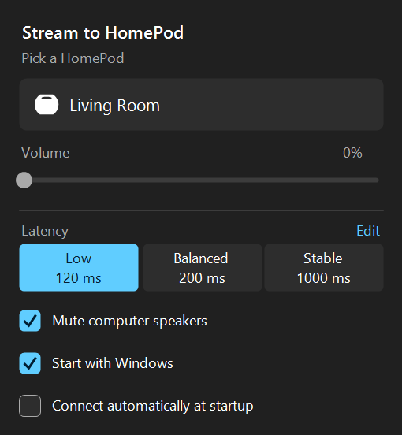

# PodBridge

[](https://github.com/Heymez0/PodBridge/releases/latest)

[](LICENSE)

PodBridge streams everything you hear on a Windows PC to a HomePod or HomePod mini over AirPlay 2.
It lives in the system tray, needs no audio driver, and comes with a browser extension that keeps
video in sync with the delayed audio.

The interface is available in English and Turkish.

<p align="center">
  
</p>

**[Download the latest release](https://github.com/Heymez0/PodBridge/releases/latest)**: `PodBridge.exe` (Windows 10/11 x64, no .NET needed) and the browser extension zip. See the [code signing policy](#code-signing-policy).

## Contents

- [Features](#features)
- [Requirements](#requirements)
- [Installation](#installation)
- [Using PodBridge](#using-podbridge)
- [Latency](#latency)
- [Browser extension: video sync](#browser-extension-video-sync)
- [How it works](#how-it-works)
- [Updates](#updates)
- [Troubleshooting](#troubleshooting)
- [Building from source](#building-from-source)
- [Command-line tools](#command-line-tools)
- [Known limitations](#known-limitations)
- [Changelog](#changelog)
- [Code signing policy](#code-signing-policy)
- [Privacy](#privacy)
- [License and credits](#license-and-credits)

## Features

- **System-wide audio.** Whatever plays on the default Windows output goes to the HomePod. Captured with WASAPI loopback, so no virtual audio driver is installed.
- **AirPlay 2 realtime streaming.** Lossless ALAC, encrypted end to end like Apple's own senders. Pairing is transient: no PIN, nothing stored on the HomePod.
- **Feels built in.** While streaming, the Windows volume keys and taskbar slider control the HomePod volume, the mute key mutes the HomePod, and the computer's speakers are muted. Everything is restored when you disconnect.
- **Low latency presets.** Low, Balanced and Stable presets, each with an editable buffer length.
- **Video sync extension.** For Chrome, Edge, Brave, Opera and Firefox. Delays video by the audio latency so lips and sound line up.
- **Resilient.** Reconnects after network drops and sleep, follows changes of the default audio device, and backs off politely when an iPhone takes over the HomePod.
- **Automatic discovery.** HomePods are found over mDNS; devices seen before stay in the list even when they are briefly offline.
- **Tray app.** Windows 11 style panel, light and dark theme, `Ctrl+Alt+P` hotkey, optional start with Windows and auto-connect.

## Requirements

- Windows 10 or 11, 64-bit
- HomePod or HomePod mini on the same local network
- In the Home app, **Home Settings > Speakers & TV > Allow Speaker & TV Access** must allow your computer, for example **Everyone on the Same Network**
- No .NET installation needed; the release is self-contained

## Installation

1. Download `PodBridge.exe` from the latest release.
2. Put it in a permanent folder, for example `C:\Users\<you>\PodBridge`. The firewall permission is tied to this path; if you move the file later, PodBridge asks for the permission again.
3. Run it. Windows SmartScreen may warn because the app is not signed: choose **More info > Run anyway**.
4. On first launch PodBridge adds itself to startup and to the Start menu. Both can be undone from the panel or with **Uninstall…** in the tray menu.
5. The first time you connect, Windows shows a UAC prompt. PodBridge adds one inbound firewall rule: UDP only, for this program only, from the local subnet only. The HomePod needs it to send clock sync and retransmit requests.

If **Smart App Control** is turned on, Windows blocks unsigned programs that have no reputation, and PodBridge will not start.

## Using PodBridge

Click the tray icon to open the panel.

| Control | What it does |
|---|---|
| HomePod list | Click a HomePod to stream to it, click it again to stop. |
| Volume | HomePod volume. The Windows volume keys do the same while streaming. |
| Latency: Low / Balanced / Stable | Buffer size of the stream. Takes effect immediately; an active stream reconnects for a moment. |
| Latency: Edit | Change the buffer length of each preset (50 to 2000 ms). |
| Mute computer speakers | Mutes the local speakers while streaming. |
| Volume keys control the HomePod | While streaming, the volume and mute keys and the taskbar volume slider control the HomePod. Turn off to keep them on the computer. |
| Start with Windows | Adds or removes PodBridge from startup. |
| Connect automatically at startup | Reconnects to the last HomePod when PodBridge starts. |

The tray icon shows a blue dot while streaming and an orange dot when something needs attention.
`Ctrl+Alt+P` connects to or disconnects from the last used HomePod.

While streaming, the volume up and down keys change the HomePod volume in 2% steps (hold to repeat), the mute key mutes and unmutes the HomePod, and the taskbar volume slider follows the HomePod. PodBridge takes the keys for itself during streaming, so Windows never unmutes the computer's speakers; instead of the Windows volume pop-up, PodBridge shows its own in the same place, with the HomePod level. When streaming stops, or with **Volume keys control the HomePod** turned off, the keys work on the computer as usual.

Right-click the tray icon for **Open log folder**, **Language**, **Check for updates**, **Update automatically**, **Prioritize audio on the network**, **Uninstall…** and **Exit**.

### Stereo with two HomePods (experimental)

There are two ways to play in stereo on two HomePods:

- **A pair made in the Home app** shows up in the list as one entry, "Name (stereo pair)". PodBridge sends the full stereo signal to both HomePods; whether they split it into left and right is up to the HomePods. Reports from other AirPlay senders say original HomePods do and HomePod minis may play full stereo on both.
- **A pair made in PodBridge** works with any two HomePods that are not paired in the Home app. In the panel, click the small **Stereo…** link at the top right, pick a **Left speaker** and a **Right speaker**, and a "Left + Right (stereo)" entry appears in the panel. PodBridge sends the left channel to one and the right channel to the other.

Both HomePods get one session each on a single timeline: the audio is read from the capture once, every packet carries the same timestamp on both, and both sync to the same clock. Volume and the volume keys apply to both. If one HomePod drops out, both are restarted together. Both kinds are untested with real hardware so far; how closely two HomePods stay in step in this mode is not measured.

**Prioritize audio on the network** (on by default) tags the stream's packets for the priority queues and pauses Wi-Fi background scans while streaming. If you hear crackles or short cuts, try turning it off: some routers handle tagged packets worse than plain ones. Changing it restarts an active stream.
The interface language is English or Türkçe; the default follows the Windows display language.

## Latency

AirPlay buffers audio on the speaker, so sound always arrives a little late. PodBridge lets you trade buffer size for robustness.

End-to-end latency was measured with a microphone: a click played on the Windows output, timed until it came out of a HomePod mini on Wi-Fi.

| Preset | Buffer (default) | End-to-end latency | Notes |
|---|---|---|---|
| Low | 120 ms | about 420 ms | Measured. Clean on the test network. |
| Balanced | 200 ms | about 570 ms | Measured. |
| Stable | 1000 ms | about 1.4 s | Estimated from the trend, not measured. |

- At 50 ms the latency was about 270 ms but crackling was heard. The HomePod asks for packets 70 ms ahead and Wi-Fi jitter adds to that, so buffers below about 100 ms are risky.
- Your numbers depend on the network. Wired Ethernet on the PC side usually helps.
- PodBridge's own capture buffer is about 30 ms; most of the latency is the HomePod's buffer and processing.

## Browser extension: video sync

Because AirPlay audio arrives late, video in the browser runs ahead of the sound. Apple devices hide this by delaying the picture. The extension does the same: while PodBridge streams to a HomePod, it shows each video frame as late as the audio, then turns itself off when streaming stops.

The extension follows the browser language (English or Turkish).

### Install

The extension is in the `BrowserExtension` folder (also attached to the release as a zip).

**Chrome, Edge, Brave, Opera**

1. Open the extensions page: `chrome://extensions`, `edge://extensions`, `brave://extensions` or `opera://extensions`.
2. Turn on **Developer mode**.
3. Click **Load unpacked** and select the `BrowserExtension` folder.
4. Pin the extension from the puzzle icon so its button stays visible.

**Firefox 132 or newer**

1. Open `about:debugging#/runtime/this-firefox`.
2. Click **Load Temporary Add-on…** and select `manifest.json` in the `BrowserExtension` folder.
3. Click the extension button and choose **Allow access to local PodBridge**.

A temporary add-on is removed when Firefox closes. Permanent installation needs signing by Mozilla.

Safari is not supported.

### Use

Open the extension popup to see the status, turn sync on or off, and fine-tune the delay by ±300 ms if the picture is still slightly ahead of or behind the sound.

### How the extension gets the delay

PodBridge serves its state at `http://127.0.0.1:47389/status`:

```json
{ "app": "PodBridge", "streaming": true, "latencyMs": 420, "device": "Living Room" }
```

- Bound to `127.0.0.1`, so it is reachable only from this computer.
- No CORS headers, so web pages cannot read it; only the extension can.
- Requests with a foreign `Host` header are rejected, which blocks DNS rebinding.
- `latencyMs` is the end-to-end estimate for the active preset, interpolated from the measurements above.

### Extension limitations

- Netflix, Disney+ and other DRM-protected video cannot be copied by the browser, so it plays normally without delay.
- Captions and player controls are not delayed.
- If a site makes the `<video>` element itself fullscreen (most sites fullscreen the player container instead), the delay stops while fullscreen.

## How it works

```
Windows audio ──► WASAPI loopback ──► resampler ──► ring buffer ──► AirPlay 2 sender ──► HomePod
 (default output)   (+ silent stream     (sinc, drift      (30 ms)       (ALAC, ChaCha20,
                     to keep it alive)    compensation)                    RTP over UDP)
```

**Audio capture** (`Audio/LoopbackSource.cs`). WASAPI loopback on the default render device. A silent render stream keeps the capture running when nothing plays. Any channel layout is downmixed to stereo, resampled to 44.1 kHz with a 32-tap Kaiser-windowed polyphase sinc filter (104 dB SNR in the self-test) and dithered to 16 bits. The sample rate is trimmed by up to ±0.3% to absorb drift between the sound card clock and the network timeline.

**AirPlay 2 session** (`Protocol/AirPlaySession.cs`):

1. HAP transient pair-setup (SRP-6a with the fixed PIN 3939, 3072-bit group, SHA-512).
2. The RTSP control channel switches to ChaCha20-Poly1305 framing; keys come from HKDF-SHA512 over the SRP session key.
3. `GET /info`, session `SETUP` (binary plist, NTP timing), event channel, `RECORD`, stream `SETUP` (realtime type 96, ALAC).
4. Audio: 352-frame uncompressed ALAC packets, encrypted with the first 32 bytes of the pairing secret, sent over RTP/UDP and paced from a high-resolution timer on an MMCSS "Pro Audio" thread.
5. Sync packets every second, an NTP timing responder, a retransmit backlog, `POST /feedback` keep-alives and answers on the encrypted event channel keep the session healthy.

**Speakers and volume** (`Audio/LocalOutputControl.cs`). The local endpoint is muted and its volume slider is mapped to the HomePod volume. Loopback capture is unaffected by the endpoint mute or volume (verified with `--probe-volume`). The previous state is saved to disk and restored even after a crash.

**Discovery** (`Protocol/MdnsBrowser.cs`). One-shot mDNS queries for `_airplay._tcp` from a random port on every active interface; only HomePods (`AudioAccessory*` models) are listed.

**Reconnection** (`BridgeEngine.cs`). Backoff of 1, 2, 4, 8, 15 and 30 seconds, with a fresh mDNS lookup each time in case the address changed. If the HomePod closes the session after it has been running, PodBridge assumes another device took over and does not fight back.

**Video sync** (`BrowserExtension/delay-core.js`). An opaque canvas is placed over each video. On every animation frame the current video frame is copied with `createImageBitmap`, queued with a due time of now plus the delay, and drawn on the canvas when due. The video stays visible underneath because browsers stop presenting frames of a transparent video.

### Project layout

| Path | Contents |
|---|---|
| `Program.cs` | Entry point, single-instance handling, command-line tools |
| `BridgeEngine.cs` | Session lifecycle, reconnects, volume |
| `Settings.cs` | Settings, latency presets and estimates, log |
| `StatusServer.cs` | Local status endpoint for the extension |
| `FirewallRule.cs` | Firewall rule through an elevated copy of the app |
| `Protocol/` | AirPlay session, SRP, TLV8, binary plist, ALAC, encrypted framing, mDNS |
| `Audio/` | Loopback capture, resampler, local speaker control |
| `Ui/` | Tray controller, panel, preset editor, icons, translations |
| `BrowserExtension/` | Video sync extension (Manifest V3) |
| `tools/delay-test.html` | Measures the extension's delay core in a browser |
| `SelfTest.cs`, `LatencyMeter.cs` | Unit tests and measurement tools |

## Updates

PodBridge 2.1.0 and newer update themselves:

1. Once a day (first check a minute after start) PodBridge asks GitHub for the latest release.
2. If it is newer, `PodBridge.exe` is downloaded to `%LOCALAPPDATA%\PodBridge\update` and checked against the SHA-256 digest GitHub lists for the file. A download that does not match is deleted.
3. The update is installed only when nothing is streaming and the panel is closed: right away, 30 seconds after streaming stops, or at the next start of PodBridge. PodBridge restarts and shows a notification.

The new version replaces the exe in the same folder, so the firewall rule and startup entry keep working. If the folder is not writable (for example under Program Files), PodBridge says so and you can download the release by hand.

Use **Check for updates** in the tray menu to check now, and **Update automatically** to turn it off. The browser extension does not update itself; reload it from the release zip when its version changes.

Versions before 2.1.0 have no updater: download 2.1.0 once by hand.

## Troubleshooting

**"Firewall permission needed".** The HomePod's timing packets cannot reach the PC. Click **Allow** in the panel and accept the UAC prompt. The network profile does not matter; the rule covers all profiles but only the local subnet.

**"The HomePod refused pairing".** Check **Allow Speaker & TV Access** in the Home app (see Requirements).

**No HomePod found.** The PC and HomePod must be on the same network and subnet. Some routers block mDNS between Wi-Fi and Ethernet, or between bands.

**Crackling or dropouts.** Switch to Balanced or Stable, or raise the Low buffer with **Edit**, and try turning off **Prioritize audio on the network** in the tray menu. Every 30 seconds the log records underruns, retransmits and capture skips (buffered audio dropped on the computer), and every retransmit request is logged with how long ago the requested packets were sent; a request older than the buffer cannot be played in time.

**Sound comes from the PC speakers as well.** Turn on **Mute computer speakers**.

**Logs.** `%LOCALAPPDATA%\PodBridge\log.txt`, or **Open log folder** in the tray menu.

## Building from source

Requires the .NET 10 SDK.

```bash
dotnet publish PodBridge.csproj -c Release -o dist
```

The output is a single self-contained `PodBridge.exe` (about 50 MB, compressed, ReadyToRun).

To regenerate the icons after changing `Ui/Glyphs.cs`:

```bash
PodBridge --write-icon app.ico
PodBridge --write-extension-icons BrowserExtension/icons
```

## Command-line tools

| Command | Purpose |
|---|---|
| `PodBridge --selftest` | Unit tests: ALAC bit layout, binary plist, TLV8, SRP, encrypted framing, resampler quality, mDNS parsing, latency presets, status endpoint, QoS and Wi-Fi calls, release parsing |
| `PodBridge --test --ip <ip> --seconds 30 --latency 5292 [--loopback] [--tone 440] [--volume 25]` | Stream a tone or the PC audio to a HomePod without the UI |
| `PodBridge --measure --ip <ip> --latency 5292 --volume 25` | Measure end-to-end latency with the microphone (data stays in memory) |
| `PodBridge --sweep --ip <ip> --values 200,150,120,100 --seconds 15` | Play the PC audio with a series of buffers to find the smallest clean one by ear |
| `PodBridge --probe-volume` | Check that loopback capture is independent of the endpoint volume |
| `PodBridge --probe-keys` | Press the volume and mute keys in software and check that they reach PodBridge without unmuting the speakers; volume and mute are restored |
| `PodBridge --audio-status` | List output devices and the apps playing on them |
| `PodBridge --render-ui <png> [--language tr]` | Render the panel to an image |
| `PodBridge --render-osd <png> [--percent 42] [--muted] [--light] [--scale 1.5]` | Render the volume pop-up to an image |

`--latency` is in frames at 44.1 kHz (5292 frames = 120 ms).

## Known limitations

- PodBridge does not appear as a separate device in the Windows sound list; that would need a signed kernel driver. It captures whatever goes to the default output.
- Only HomePods are listed. Apple TV and Mac receivers need PIN pairing, which is not implemented.
- Stereo with two HomePods is experimental and has not been tried on real hardware. Multi-room playback (the same audio on several HomePods in different rooms) is not offered.
- Games and other apps without A/V sync still feel the latency.
- The executable is not code-signed.

## Changelog

### 2.2.0

- **Volume and mute keys go straight to the HomePod** while streaming. PodBridge takes the keys itself, so the computer's speakers are never unmuted for a moment by volume up. The mute key mutes the HomePod; the next press or a volume key brings the sound back.
- **Volume pop-up**: since the keys no longer reach Windows, PodBridge shows a pop-up like the Windows 11 one, with a HomePod icon and the HomePod level.
- **Stereo with two HomePods (experimental)**: a stereo pair from the Home app shows up as one entry, and any two other HomePods can be made a left/right pair with the **Stereo…** link in the panel. Both HomePods play on one shared timeline.
- **Network priority can be turned off** in the tray menu, and the log now records capture skips and the age of each retransmit request, to track down crackles.
- **New panel option, Volume keys control the HomePod** (on by default), to leave the keys to the computer. The link no longer depends on Mute computer speakers.
- **Windows 11 style menus and dialog**: the tray menu, the stereo picker and the latency presets window have rounded corners, Windows 11 buttons and fields, and follow the Windows light or dark theme.
- If you stop streaming while the HomePod is muted, its previous volume is restored.
- After a short Wi-Fi drop, the HomePod sometimes closes the new session while it cleans up the old one. PodBridge took that for another device taking over and gave up; it now keeps reconnecting for a minute after a drop.

### 2.1.0

- **Automatic updates.** PodBridge checks GitHub once a day, verifies the download against GitHub's SHA-256 digest and installs it when nothing is streaming. Can be turned off in the tray menu.
- **Fewer dropouts on Wi-Fi**: stream packets are tagged for the Wi-Fi priority queues, and Wi-Fi background scans on the PC are paused while streaming.
- **Sturdier sessions**: RTSP replies matched by CSeq, a failed volume query no longer drops the stream, audio and capture threads recover from errors instead of closing the app.
- The language switch moved from the panel to the tray menu.

### 2.0.0

- **Browser extension for video sync** (Chrome, Edge, Brave, Opera, Firefox) and the local status endpoint it reads.
- **English and Turkish interface**; the extension follows the browser language.
- **Editable latency presets** with live latency estimates. Low is now 120 ms (was 50 ms, which crackled).
- **New look**: HomePod mini app and tray icons, theme-aware tray icon with status dot, themed preset editor with dark title bar.
- Source code, comments and documentation are in English.

### 1.0.0

- First release: AirPlay 2 realtime streaming to HomePod, WASAPI loopback capture, tray panel, reconnects, speaker muting and volume mapping, firewall setup.

## Code signing policy

Free code signing provided by [SignPath.io](https://about.signpath.io), certificate by [SignPath Foundation](https://signpath.org).

- Release binaries are built from this repository by the [Release workflow](.github/workflows/release.yml) on GitHub-hosted runners, never on a personal computer. The workflow runs the self-test before anything is signed.
- Only `PodBridge.exe` built from this repository is signed. Third-party libraries (NAudio) are not signed by this project.
- Only tag builds (`v*`) are signed, and every signing request is approved by hand. The signed file's product name and version must match `PodBridge` and the version in `PodBridge.csproj`.
- Everyone on the team uses multi-factor authentication for GitHub and SignPath.
- Releases published before the signing setup was in place (1.0.0 and the first 2.0.0 build) are unsigned.

Team roles:

- Committers and reviewers: [Heymez0](https://github.com/Heymez0)
- Approvers: [Heymez0](https://github.com/Heymez0)

Contributions from anyone else arrive as pull requests and are reviewed before they are merged.

## Privacy

This program will not transfer any information to other networked systems unless specifically requested by the user or the person installing or operating it.

In practice: audio goes only to the HomePod you pick, on your local network. The browser extension talks only to PodBridge on the same computer (`127.0.0.1`). There is no telemetry and no account.

The only request to the internet is the update check: once a day PodBridge asks the public GitHub API for the latest release of this repository (`api.github.com/repos/Heymez0/PodBridge/releases/latest`) and, when there is a newer version, downloads `PodBridge.exe` from GitHub. The request carries nothing but PodBridge's version in the `User-Agent` header; GitHub sees your IP address as with any web request ([GitHub's privacy statement](https://docs.github.com/site-policy/privacy-policies/github-general-privacy-statement)). Turn off **Update automatically** in the tray menu to stop it. Settings and the log stay in `%LOCALAPPDATA%\PodBridge`.

## License and credits

PodBridge is released under the [MIT License](LICENSE).

The AirPlay 2 sender was written from scratch in C#, using [airplay2-sender-cpp](https://github.com/akustikrausch/airplay2-sender-cpp) (Apache-2.0) and [pyatv](https://github.com/postlund/pyatv) (MIT) as protocol references; no code was copied. Audio capture uses [NAudio](https://github.com/naudio/NAudio) (MIT). See [NOTICE.txt](NOTICE.txt).

PodBridge is an independent project and is not affiliated with, authorized or endorsed by Apple Inc. AirPlay and HomePod are trademarks of Apple Inc., used only to describe compatibility. PodBridge contains no Apple code, keys or certificates.
